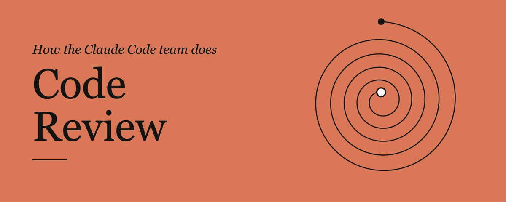
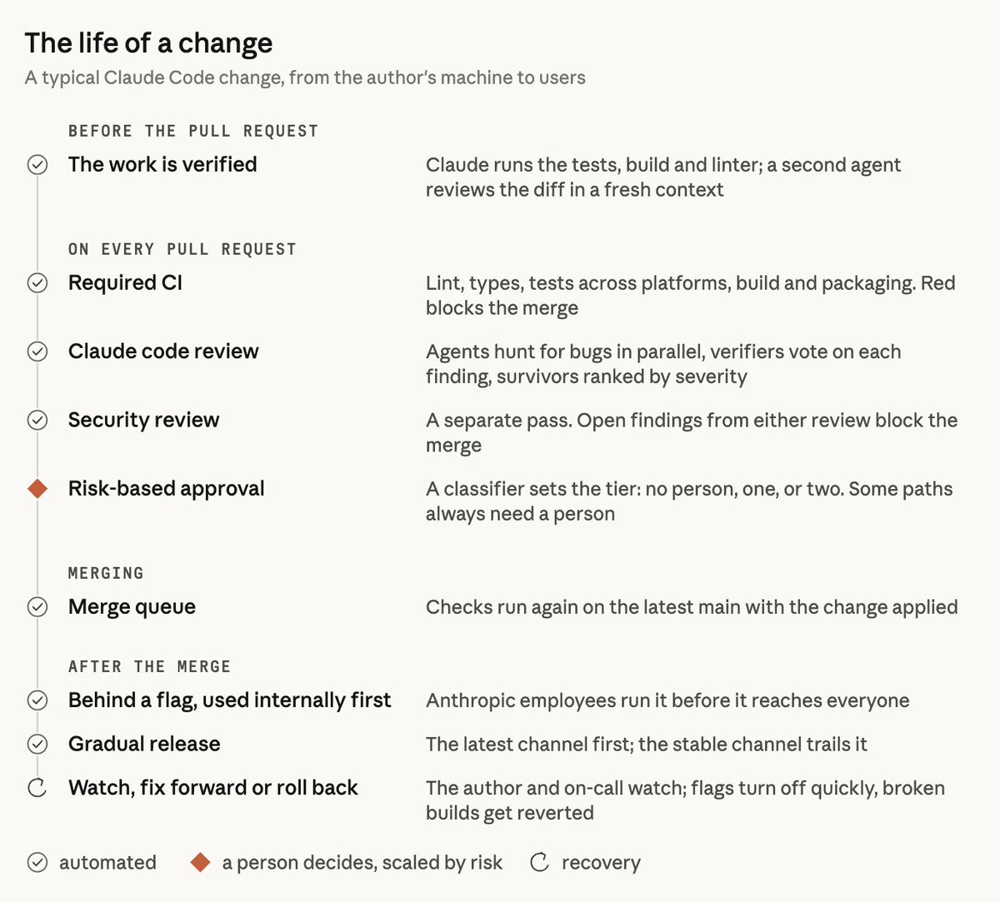
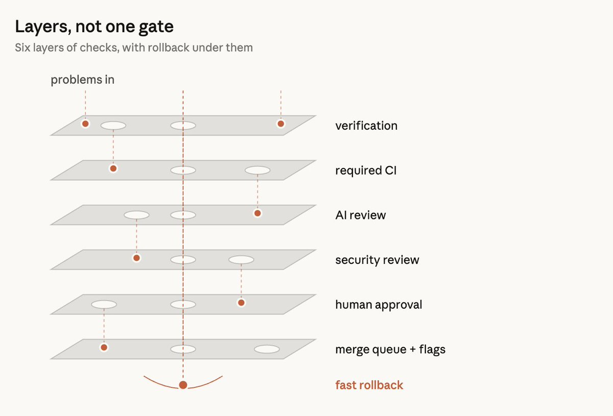
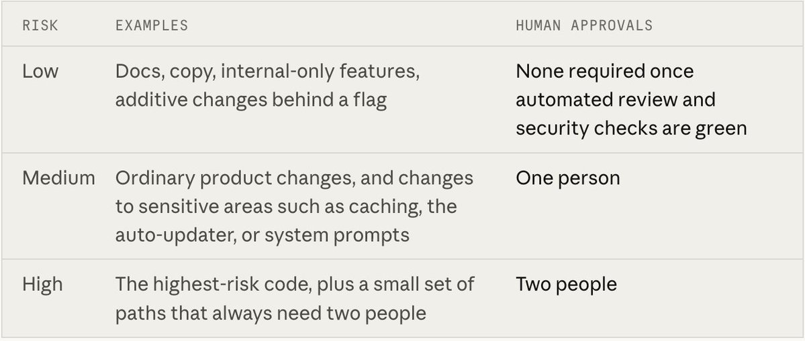
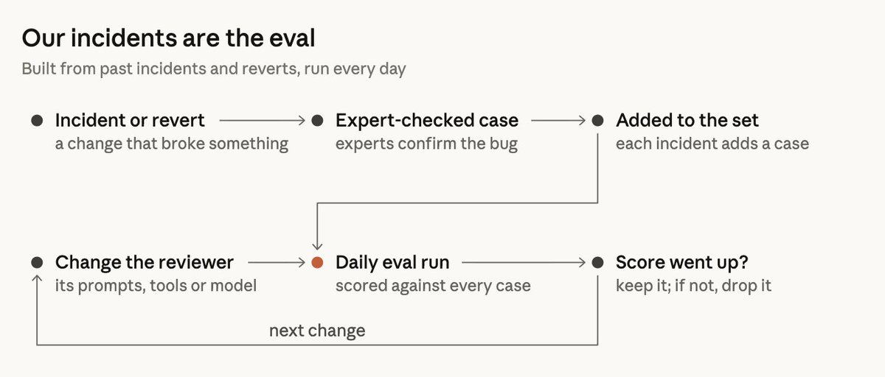
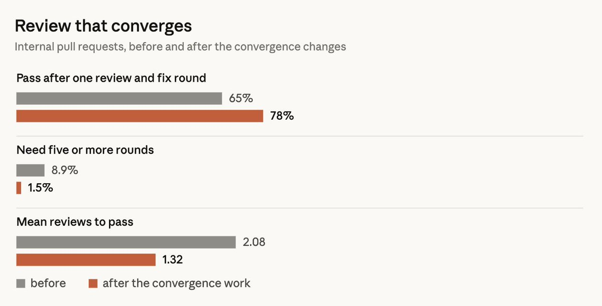
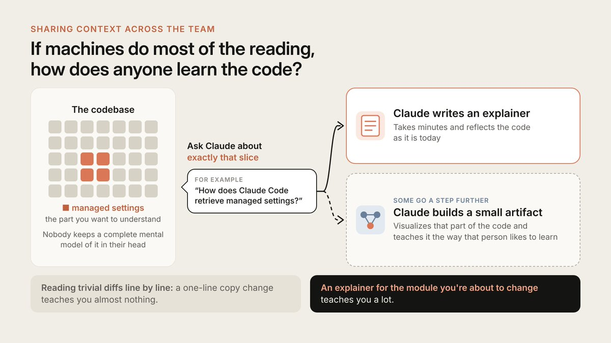

# How the Claude Code team does code review
# Claude Code 团队是如何做代码审查的

We previously mentioned that Claude writes about 90 percent of the code for Claude Code. So how do we do code review at this scale? Who reads code anyway? What happens if code goes wrong?

我们之前提到过，Claude Code 约 90% 的代码都是由 Claude 自己编写的。那么，在这种规模下我们该如何进行代码审查（Code Review）？到底还有谁在读代码？如果代码出了问题怎么办？

This post describes our team's code review process at Claude Code and how we have improved it. Between June and September, we saw more than double the number of pull requests that were merged to the codebase for Claude Code, while the share of pull requests that had to be reverted fell by more than 40 percent.

这篇文章介绍了我们 Claude Code 团队的代码审查流程，以及我们是如何改进它的。在 6 月至 9 月期间，合并到 Claude Code 代码库的 Pull Request（PR）数量翻了一倍多，而需要回滚（revert）的 PR 比例却下降了 40% 以上。

We didn't stop doing code review. Instead, we've automated the majority of reading and tuned it to optimize for human time and effort. We've also made significant investments into improving the speed and ease of reverting mistakes.

我们并没有停止做代码审查。相反，我们将绝大部分“读代码”的工作自动化了，并对其进行了调优，以最大化节省人类的时间和精力。同时，我们也投入了大量精力来提升回滚错误的响应速度和便捷度。

---

## Rethinking the goal of code review
## 重新思考代码审查的目标

With agents writing code, the volume of changes increases rapidly. In our monorepo, we went from approximately 2,500 changes merging each day in May to over 30,000 in [September](https://www.anthropic.com/engineering/redesigning-source-control) of this year.

随着智能体（Agent）开始编写代码，代码变更的体量正在急剧增长。在我们的单体仓库（monorepo）中，每天合并的变更数量从今年 5 月的大约 2,500 个，飙升到了 [9 月](https://www.anthropic.com/engineering/redesigning-source-control)的 30,000 个以上。

While Claude Code is not in our monorepo, it has a lot of pressure on it as well. When you're moving fast like that, it becomes increasingly hard, if not impossible, to do code review manually, line by line.

虽然 Claude Code 不在我们的 monorepo 中，但它同样面临着巨大的吞吐压力。当开发速度如此之快时，再靠人工逐行进行代码审查变得越来越困难，甚至几乎不可能。

**Code review serves two purposes:**
1. Detect and correct bugs before they ship
2. Develop a shared understanding of the codebase

**代码审查主要服务于两个目标：**
1. 在发布前发现并修复 Bug
2. 建立团队对代码库的共同理解（Shared Understanding）

While this article focuses primarily on the first goal, we'll discuss the second goal toward the end of the post.

虽然本文主要聚焦于第一个目标，但我们也会在文章末尾探讨第二个目标。

We view "did someone read the code?" as an imprecise measure of "what could go wrong with this change, and what check - automated or human - is the right one to catch it?"

我们认为，问“有人读过这段代码了吗？”是一个不够精确的衡量指标；真正应该问的是：“这次变更可能会出什么问题？用哪种检查方式——自动化还是人工——最适合捕捉到它？”

This question also changed the timing of code review. Traditionally, code review was a check performed after the fact, when the code was written, the PR was filed, and someone waited for someone else to take a look. Instead, we've integrated code review into the workflow. It's more like a spellcheck that you continuously do while writing.

这个问题也改变了代码审查发生的时机。传统上，代码审查是一种“事后检查”——等代码写完、提交了 PR，然后等着另一个人来看。相反，我们把代码审查直接集成到了工作流中。它更像是你在打字时持续运行的“拼写检查”。

The majority of changes have already been reviewed and corrected by Claude, at least once, before a human is asked to take a look. In this way, we catch most of the routine bugs and reserve human attention for more high-level considerations.

绝大多数代码变更在请求人类介入查看之前，都已经由 Claude 审查并修正过至少一次了。通过这种方式，我们拦截了大部分常规 Bug，从而把人类的注意力保留给更高维度的考量。

---

## Human time and attention
## 人类的时间与注意力

We want to reserve human time and attention for things only humans can handle, while making sure we have enough automation to cover the rest. Even at our current pace, there is still an incredible amount of work for humans to do, and our team is encountering new and novel challenges almost every day.

我们希望把人类的时间和注意力留给只有人类才能处理的事情，同时确保有足够的自动化机制来覆盖其余部分。即便在目前的节奏下，仍然有极其庞大的工作需要人类去完成，而且我们的团队几乎每天都在遇到前所未有的新挑战。

For this reason, human time is a dual-sided cost. Not only do we count the time people spend doing code review, but also the time that they spend fixing bugs that are introduced by bad code. If we reduce the first without reducing the second, we're not really saving human time.

因此，人类的时间是一种“双面成本”。我们不仅要计算人们花在代码审查上的时间，还要计算他们花在修复由糟糕代码引入的 Bug 上的时间。如果我们只减少了前者，却没有减少后者，那我们并没有真正节省人类的时间。

So, our goal is that the majority of pull requests in our Claude Code repos (the CLI, the desktop and web apps, and the mobile apps) should merge with a maximum of one person in the loop (who could be the author) without an increase in reverts or incidents.

所以，我们的目标是：在 Claude Code 的各个代码库（包括 CLI、桌面端、Web 端以及移动端应用）中，绝大多数 PR 应该在最多只有一个人介入（这个人可以就是作者本人）的情况下完成合并，同时不增加回滚率或线上事故率。

We track our human time in terms of median human approvals per PR (along with the 95th percentile), the number of human comments, and how long a PR waits on a person. We use the revert and incident rates as a guardrail: if these metrics increase, we haven't reduced human time, just relocated it.

我们通过以下几个指标来追踪人类时间成本：每个 PR 的人类批准数中位数（以及 P95 分位数）、人类评论数量，以及一个 PR 等待人工处理的时长。同时，我们将回滚率和事故率作为护栏指标（Guardrails）：如果这些指标上升了，说明我们并没有真正减少人类时间，只是把时间消耗转移到了别处。

---

## What's the journey of a change?
## 一次代码变更的生命周期是怎样的？

A typical change, whether it's from an engineer's laptop or a Claude session in Slack, goes through multiple layers of review.

一次典型的代码变更——无论它是来自工程师的笔记本电脑，还是来自 Slack 里的一个 Claude 会话——都会经过多层审查。

*FIG A: The life of a change（图 A：一次代码变更的生命周期）*

Above is the typical Claude Code change, from the author's environment to production. Most of this process is automated, with human attention focused on the risky part.

上图展示了典型的 Claude Code 代码变更从作者的开发环境走向生产环境的全过程。其中大部分流程是自动化的，人类的注意力被集中在高风险环节。

We have six layers of checks with a rollback mechanism to handle any issues that get through.

我们设置了六层检查机制，并配有一套回滚机制来处理任何漏网之鱼。

*FIG B: Layers, not one gate（图 B：多层防御，而非单一关卡）*

Each layer catches some bugs while missing others. Few bugs get through all of the layers, and if some do, we have a rollback mechanism in place.

每一层都会捕捉到一些 Bug，同时也会漏掉另一些。极少有 Bug 能穿透所有防御层；即便真的有漏网之鱼，我们也有就绪的回滚机制兜底。

### 1. Pre-PR verification:
### 1. PR 提交前的验证：

Most of our review is done before we create a PR. We ask Claude to do something runnable, such as running tests, the build, or comparing a screenshot to the design. Instead of saying the task is done, we ask it to show us the result. Then, a subagent reviews the diff with fresh context. Both these strategies are part of our [guide to best practices](https://code.claude.com/docs/en/best-practices).

我们绝大部分的审查工作在创建 PR 之前就已经完成了。我们会要求 Claude 执行可运行的验证操作，比如运行测试、执行构建，或者将界面截图与设计稿进行比对。我们不会只听它说“任务完成了”，而是要求它向我们展示结果。接着，一个拥有全新上下文的子智能体（subagent）会对 diff 进行审查。这两项策略都已写入我们的[最佳实践指南](https://code.claude.com/docs/en/best-practices)。

Before opening a PR, many of us also run a handful of internal skills -- bug hunting, diff reduction, end-to-end validation, and checking our UI changes against our design guidelines.

在发起 PR 之前，我们中的许多人还会运行一系列内部技能（Skills）——包括猎捕 Bug（bug hunting）、精简变更集（diff reduction）、端到端验证，以及对照设计规范检查 UI 变更。

According to Boris Cherny, who created Claude Code, [equipping Claude with a verification process](https://x.com/bcherny/status/2007179861115511237) is probably the biggest key to higher quality outcomes. He estimates that a verification process improves the quality of Claude's output by a factor of two to three.

正如 Claude Code 的创造者 Boris Cherny [所指出的](https://x.com/bcherny/status/2007179861115511237)，为 Claude 配备一套验证流程，可能是获得更高质量产出的最大关键。他估计，验证流程能将 Claude 的产出质量提升 2 到 3 倍。

The verification process for any given domain can be very different: Sometimes it's as simple as running a bash command. Sometimes it's running a test suite. Sometimes it's testing the app in a browser or phone simulator.

不同领域的验证流程可能截然不同：有时只是简单地运行一条 bash 命令。有时是运行一整套测试套件。有时则是在浏览器或手机模拟器中测试应用。

If the automated reviewer is consistently flagging the same issue, we fix it at the source -- via the skill itself, a lint rule, or updating documentation files like:

如果自动化审查工具总是反复标记同一类问题，我们会直接从源头修复它——通过修改对应的 Skill 本身、添加一条 lint 规则，或者更新如下文档文件：

- **CLAUDE.md** -- The project description file that you can use to give Claude context about the project (technology stack, conventions, goals, non-goals). Claude Code pulls this file in for every single review, so we keep it brief for large codebases and reference the rest of the documentation here. When code breaks a convention in this file, or an update makes something in it out of date, the reviewer flags it.
- **`CLAUDE.md`** —— 用于向 Claude 提供项目上下文的项目说明文件（技术栈、代码规范、目标与非目标）。Claude Code 在每次审查时都会加载这个文件，因此对于大型代码库，我们会保持其简明扼要，并在其中引用其余文档。当代码违反了该文件中的规范，或者某次更新导致文件中的内容过时，审查工具就会将其标记出来。
- **REVIEW.md** -- The file where code owners tell the reviewer what matters in their part of the code. We separately verify whether the reviewer is actually following these guidelines. Good ones are brief and focus on:
  - Defining project failure (the docs should not lie; the config should not misroute)
  - Limiting nitpicking
  - Defining ignored paths
  - Requiring file + line reference, not guessing filenames
  - Requiring top-level summary including count and clear statement of "no issues"
- **`REVIEW.md`** —— 代码所有者（Code Owners）用来告诉审查工具“在他们负责的代码区域里什么最重要”的文件。我们还会单独验证审查工具是否真正遵守了这些指南。优秀的 `REVIEW.md` 通常简短且聚焦于：
  - 定义什么是“项目级失败”（例如：文档绝不能撒谎；配置绝不能路由错误）
  - 限制吹毛求疵（Nitpicking）
  - 定义忽略路径（Ignored paths）
  - 要求提供“文件名 + 行号”引用，禁止猜测文件名
  - 要求提供顶层总结，包括问题计数或明确声明“无问题（no issues）”

### 2. AI review on every pull request
### 2. 每个 Pull Request 上的 AI 审查

Every PR receives a Claude review before a human review.

每个 PR 在进入人工审查之前，都会先接受一次 Claude 审查。

The diff is analyzed against the entire codebase and the intent of the PR as stated by the PR author. It checks that:
- the change actually addresses the issue
- the change fits into the larger system
- the change does not break other parts of the codebase

When reviewing a bug fix, the bot tries to find the root cause.

系统会结合整个代码库以及 PR 作者声明的意图来分析 diff。它会检查：
- 该变更是否真正解决了对应的问题
- 该变更是否契合更大的系统架构
- 该变更是否破坏了代码库的其他部分

在审查 Bug 修复时，机器人还会尝试寻找根本原因（Root Cause）。

Our public product, [Code Review for Claude Code](https://code.claude.com/docs/en/code-review), is now available to all Team and Enterprise customers. There is a lighter version for local use as well -- `/code-review`.

我们的公开产品 [Code Review for Claude Code](https://code.claude.com/docs/en/code-review) 现已向所有 Team 和 Enterprise 客户开放。同时也有一个供本地使用的轻量版本 —— `/code-review`。

Since we released the research preview, the share of our internal PRs getting substantive review comments has gone from 16% to 54%. Code Review detects issues on the majority of PRs with more than 1,000 lines and returns clean results on most smaller PRs. Repos can be configured by admins to use Quick, Standard, or Deep modes. Deep is useful in cases where the cost of missing a single bug is higher than the time spent reviewing code.

自我们发布研究预览版以来，内部 PR 获得实质性审查意见的比例从 16% 提升到了 54%。Code Review 能在绝大多数超过 1,000 行的 PR 中检测出问题，同时对大多数较小的 PR 返回干净的通过结果。管理员可以为仓库配置 Quick（快速）、Standard（标准）或 Deep（深度）模式。当漏掉一个 Bug 的代价远高于审查代码所花费的时间时，Deep 模式会非常有用。

Findings are vetted by multiple other agents before human review:
- Multiple agents run in parallel to hunt for bugs
- A separate vote decides if a finding is valid or a false positive, only confirming the findings that have enough votes
- Findings that are only style/diagnostics/cleanup related are filtered out (we A/B tested these filters on our own PRs before rolling them out)

在提交给人类审查之前，审查发现的问题（Findings）会经过多个其他智能体的交叉核验：
- 多个智能体并行运行以猎捕 Bug
- 一个独立的投票机制决定某条发现是真实有效还是误报（False Positive），只有获得足够票数的发现才会被确认
- 仅涉及代码风格、诊断信息或清理工作的发现会被过滤掉（我们在全面推开这些过滤器之前，先在自己的 PR 上进行了 A/B 测试）

The remaining findings are presented as inline comments, ordered by severity level and marked as:
- Important
- Nit
- Pre-existing (so we don't unfairly penalize the author for bugs that were not introduced by the PR)

保留下来的问题会以行内评论（Inline comments）的形式呈现，按严重程度排序，并标记为：
- Important（重要）
- Nit（小瑕疵）
- Pre-existing（历史遗留——这样我们就不会因为非本次 PR 引入的旧 Bug 而对作者做出不公平的惩罚）

All findings must be addressed -- fixed or the thread is resolved with a reason. In many cases, an agent will fix the problem overnight so the author returns to a PR that's already been through another review pass.

所有指出的问题都必须得到处理——要么修复，要么附带理由将该讨论串标记为已解决（Resolved）。在很多情况下，智能体会连夜自动修复这些问题，因此当作者第二天回来查看 PR 时，它往往已经完成了修改并走完了新一轮审查。

### 3. Security review that can block
### 3. 可阻断合并的安全审查

We also run an automated security review. No PR can be merged while there is still an open finding (either from the code review or the security review). The author can either fix the issue or close the thread with a short reason (how we deal with a false positive).

我们还会运行自动化的安全审查。只要还有任何一个未解决的问题（无论来自代码审查还是安全审查），PR 都无法合并。作者可以选择修复问题，或者填写简短理由关闭讨论串（这也是我们处理误报的方式）。

A finding will be auto-closed if a subsequent commit addresses the problem. You can set up the same thing with the open-source security review GitHub Action, or the `/security-review` command. See automated security reviews in Claude Code for a guide on how to set this up.

如果后续的提交（Commit）解决了该问题，对应的审查项会自动关闭。你可以通过开源的安全审查 GitHub Action 或 `/security-review` 命令搭建同样的机制。参见 Claude Code 中的自动化安全审查指南了解如何配置。

### 4. Automated checks that block
### 4. 可阻断合并的自动化检查

Standard checks: lint, type checks, tests on all platforms, build. (We wrote about how we scaled CI here.) A typical CLI PR can have dozens of checks run before anyone looks at it. The PR template has questions about how the change was tested and how to revert it. Claude can answer those for you, but the author is responsible for reviewing them.

标准检查包括：lint、类型检查、全平台测试、构建。（我们曾写过一篇关于如何扩展 CI 的文章）。一个典型的 CLI PR 在任何人看到它之前，可能已经运行了数十项检查。PR 模板中包含关于“该变更如何测试”以及“如何回滚”的问题。Claude 可以代你填写这些内容，但作者必须对核实这些内容负责。

### 5. Human approval, scaled by risk
### 5. 按风险分级的人工审批

Some changes are more risky than others (e.g. a docs fix vs. an auto-updater change), so they require different levels of review.

有些变更比其他变更风险更高（例如：修复文档 vs. 修改自动更新程序），因此它们需要不同级别的审查。

*FIG C（图 C：风险分级）*

The tier is determined by the change, not the author. A classifier determines the risk level based on the change. Another classifier determines if a particular change actually requires another approval, even if the tier does not say it does. Some paths always require another approval -- anything marked as sensitive by owners, and any CI workflow file.

审查级别取决于变更内容本身，而不是取决于作者是谁。一个分类器会根据变更内容判定风险等级；另一个分类器则会判定某次特定变更是否确实需要额外的人工批准（哪怕它所属的等级原本不要求）。某些路径始终需要额外批准——包括被代码所有者标记为敏感的任何文件，以及所有的 CI 工作流文件。

Only authors on the repo's trusted list receive relaxed review requirements, and that's generally the team that owns the repo. All others require a second person to approve. Agent approvals don't count as human approvals. Automated review can clear a low-risk change, but it can't stand in for a human when one is required.

只有在仓库“受信任名单（Trusted list）”上的作者才能享受宽松的审查要求，这通常就是拥有该仓库的团队成员。其他所有人都需要第二个人来批准。智能体的批准不能算作人类的批准。自动化审查可以放行低风险变更，但在需要人类把关的地方，它不能替代人类。

The author of the change is responsible for it, so if an agent authors a PR the operator of the agent is always counted as one of the required reviewers. A PR approval is only good for one commit. If a new commit lands that can't be trusted (e.g. an agent pushed something, or someone resolved a merge by hand), the PR must be reapproved.

变更的作者要对变更负责——因此，如果一个 PR 是由智能体编写的，那么操控该智能体的工程师（Operator）始终会被计入必需的审查者之一。一次 PR 批准仅对单次 Commit 有效。如果后续又推了新的不可信 Commit（例如智能体又推送了新代码，或者有人手动解决了合并冲突），则该 PR 必须重新获得批准。

### 6. Merge queue, feature flags and staged rollouts
### 6. 合并队列、特性开关与分阶段发布

The merge queue ensures that all the checks run on main with the change applied. This prevents merging two successful PRs into a broken main. Typically, new features are rolled out behind a feature flag, with Anthropic employees getting access first. Because we use the product extensively, we often notice regressions before our users do.

合并队列确保所有检查都会在 `main` 分支应用了该变更的状态下重新运行。这防止了两个各自通过测试的 PR 合并到一起后却把 `main` 分支搞挂的情况。通常，新功能都会隐藏在特性开关（Feature Flag）之后发布，由 Anthropic 内部员工最先用上。因为我们自己重度使用这款产品，所以我们通常比外部用户更早发现回归缺陷（Regressions）。

When we roll out publicly, changes go to the latest channel first, and the stable channel trails behind.

当我们向公众发布时，变更会首先进入 `latest` 渠道，而 `stable` 渠道则会滞后跟进。

### 7. Fast feedback and rollback
### 7. 快速反馈与回滚

Some bad merges will inevitably make it through. This is our last line of defense, focused on identifying these as quickly as possible. Changes behind feature flags can be disabled without deploying.

总会有一些糟糕的合并不可避免地穿透所有防线。这是我们的最后一道防线，核心在于尽可能快地识别出这些问题。隐藏在特性开关后面的变更无需重新部署即可直接关闭。

Claude Code runs a weekly on-call rotation and any incident reviews involve looking back to see what layer should have caught the problem. It's still up to the author and on-call to notice bad merges, in addition to monitoring the revert and incident dashboards. We don't yet have circuit breaker mechanisms that adjust approval requirements based on these, but it's something we're looking into as we're making progress toward less human intervention in merging.

Claude Code 实行每周轮换的值班制度（On-call rotation），任何线上事故复盘（Incident review）都会回溯检查：“本该由哪一层防线拦住这个问题？”除了监控回滚与事故仪表盘之外，目前仍然由代码作者和值班人员负责留意糟糕的合并。我们目前还没有根据这些指标自动动态调整审批要求的熔断机制（Circuit breaker），但随着我们向“更少人工干预合并”的方向推进，这是我们正在探索的方向。

One team member noted that slowing down and reducing output can actually improve accuracy, but that's mostly because the amount of work being done decreases overall. Our priority is really on improving our ability to identify and correct issues quickly.

有团队成员指出，放慢速度、减少产出确实能提高准确率，但那主要是因为总体工作量减少了。我们的优先事项是真正提升我们快速发现并修正问题的能力。

---

## How we make the reviewer better
## 我们如何让审查系统变得更好

Our code review process is an ongoing cycle of improvement:

我们的代码审查流程是一个持续改进的闭环：

We use incidents as an evaluation metric. The team collected incident-causing PRs, their fix-forwards and reverts, and had the engineers who understand the codebase verify the location and correctness of each bug. The review system is evaluated daily against this collection.

我们将线上事故（Incidents）作为评估指标（Eval）。团队收集了引发事故的 PR、它们的向前修复（Fix-forwards）以及回滚记录，并请最懂代码库的工程师核实每个 Bug 的具体位置与准确性。审查系统每天都会基于这个样本集进行评估。

*FIG D: Our incidents are the eval（图 D：我们的线上事故就是评估集）*

Every incident adds to the collection and every change to the review system is evaluated against the entire collection.

每一次新事故都会补充进这个集合，而对审查系统的每一次修改都会在整个事故集合上跑一遍评估。

To measure noise, we observe how humans react to the review comments. It's easy to improve our bug-finding rate if we're okay with reporting lots of non-bugs, so this needs to be regulated. We categorize each review comment into how the person on the PR handled it: fixed the issue, rejected it, clarified it as intentional, or decided it didn't matter. Additionally, we run the review system on PRs we know to be clean and observe how often the system reports something that would have resulted in a harmful change.

为了衡量噪音（Noise），我们会观察人类对审查评论的反应。如果我们不在乎报出一堆非 Bug 的假警报，想要提高 Bug 检出率是很容易的，所以必须对此加以约束。我们将每条审查评论按 PR 负责人的处理方式进行分类：修复了问题、拒绝了建议、澄清这是有意为之，或者认为无关紧要。此外，我们还会把审查系统放到我们已知完全干净的 PR 上运行，观察系统有多大概率会报出那些一旦采纳反而会导致有害修改的建议。

Our stated priorities are first, detecting real bugs, and second, reducing the number of review cycles.

我们明确的优先级是：第一，检测出真正的 Bug；第二，减少审查轮数（Review cycles）。

It's more costly for an author to have to deal with a review comment when they're an agent. It only takes a second for a human to dismiss a nit, but when an agent has to address it, this results in another commit, and another cycle of review.

当作者是一个智能体时，处理一条审查评论的成本反而更高。人类忽略一条吹毛求疵的建议（Nit）只需要一秒钟，但当智能体去处理它时，就会产生一次新的 Commit，进而触发新一轮的审查循环。

The review process must converge. It's possible for an agent author and an agent reviewer to cycle forever. We observed one PR in our CLI project cycle more than fifty times overnight, due to the back-and-forth between the agent author and the agent reviewer. This cycle was stopped manually, but it could have gone on indefinitely.

审查过程必须收敛（Converge）。智能体作者和智能体审查员之间是有可能陷入无限死循环的。我们曾在 CLI 项目中观察到一个 PR 在一夜之间循环了 50 多次，原因就是智能体作者和智能体审查员在来回拉锯。那次循环最后被人工叫停了，否则它可能会永远跑下去。

When we ran git blame on what the review system kept flagging, ~59% of it was code that had been there since its first pass. Essentially, the review system was rarely finding new bugs, but finding a few more old ones on each cycle.

当我们对审查系统反复标记的代码运行 `git blame` 时，发现其中约 59% 的代码从第一轮审查时就已经在那里了。本质上，审查系统很少是在发现新引入的 Bug，而是在每一轮循环中又多抠出几个旧问题。

We made this worse because we had gotten into the habit of running several review cycles by default, because each cycle can find a different bug. While it can be useful to iterate through several review cycles for a high-risk change, it's not needed for every PR. Our team started tracking the number of cycles-to-pass in addition to recall, and updated re-review to:
- Limit the number of cycles. The review system asks the author to re-evaluate the approach after three cycles.
- Limit re-review to just diff after the initial cycles.
- Specify the class of bugs, so the author can correct all of them, not just one line.
- Avoid re-reporting issues already observed.
- The review agents are also run on the current codebase overnight, helping us identify historical bugs before they propagate.

我们自己也曾让情况变得更糟，因为我们一度养成了默认跑好几轮审查的习惯（因为每一轮都可能发现不同的 Bug）。虽然对于高风险变更来说，迭代多轮审查很有用，但并不是每个 PR 都需要这样做。因此，我们的团队开始在追踪召回率（Recall）的同时追踪“通过审查所需的轮数（Cycles-to-pass）”，并将重审（Re-review）逻辑更新为：
- 限制审查轮数。在经历三轮循环后，审查系统会要求作者重新评估整体实现方案。
- 在初始几轮之后，仅对新增的 diff 进行重审。
- 指明 Bug 的类别（Class of bugs），让作者一次性修复所有同类问题，而不是只改被指出的那一行。
- 避免重复报告已经观察到的问题。
- 审查智能体还会在夜间对当前整个代码库运行扫描，帮助我们在历史遗留 Bug 扩散之前将它们识别出来。

*FIG E: Review that converges — Reduction in the average number of review rounds per internal pull request after Convergence（图 E：收敛式审查——引入收敛机制后，内部 PR 平均审查轮数的下降）*

---

## Humans in the loop
## 回路中的人类

Having a senior engineer stop working to review a common error is an expensive process compared to automating that process. Human reviewers are still essential for some tasks:

让一位资深工程师停下手头的工作去审查一个低级常见错误，与将其自动化相比是极其昂贵的。但在以下任务中，人类审查者依然不可或缺：

- **Should we even build this?** Deciding whether or not to build something, setting the vision, taste, and goals for the product. (One team that claims they have solved the bottleneck of code review still performs human review for changes from outside the team to ensure that it is the right thing to build.)
- **“我们到底该不该做这个功能？”** 决定是否要构建某样东西，把控产品的愿景、品味（Taste）和目标。（有一个声称已经解决代码审查瓶颈的团队，依然会对来自团队外部的变更进行人工审查，以确保那是真正应该构建的东西。）
- **Auditing dangerous code** (billing, auto-updater, CI workflows).
- **审计高危代码**（计费系统、自动更新器、CI 工作流）。
- **Architecture review**, because those choices set the conventions others follow.
- **架构审查**，因为这些架构选择会设定其他人后续遵循的规范。
- **Verifying proofs** (test output, commands run, screenshots, reviewer comments). If you can't describe what the checks would miss, don't ask for a 👍, you need a real review!
- **核验证据（Verifying proofs）**（测试输出、运行过的命令、截图、审查员评论）。如果你说不出自动化检查会漏掉什么，就别随便求一个 👍（Approve），你需要的是一次真正的人工审查！
- **Taking responsibility.** A person answers for every change that ships, whoever typed it.
- **承担责任。** 无论代码是谁敲出来的，每一个发布的变更背后都必须有一个具体的人来负责。

---

## Team context
## 团队上下文与知识共享

Code review has always served the dual purpose of communicating codebase changes. Reading the diff of a colleague's change is how people usually understand what has changed, and how the codebase works. If the bulk of the reading is done by machines, what becomes the way to learn the codebase?

代码审查历来承担着双重使命，其中之一就是传递代码库的变更信息。阅读同事提交的 diff，通常是大家了解代码发生了什么变化以及代码库如何运作的方式。如果绝大部分阅读工作都交给了机器，那么人们该如何学习代码库呢？

We don't have any formal mechanism for this. No member of the team has a full mental model of Claude Code in their head, nor do we think anyone needs to. Rather, when anyone wants to learn about a piece of the codebase, they ask Claude to generate an explainer about that exact slice. It only takes a few minutes and the explainer is always up to date.

对此我们并没有设立任何正式的制度。团队里没有任何一个人的脑子里装有 Claude Code 的完整心智模型，我们也不认为有任何人需要具备这种全知模型。相反，当任何人想要了解代码库的某个部分时，他们会直接让 Claude 针对那个精确的切片生成一份讲解文档（Explainer）。这只需要几分钟，而且生成的讲解永远是基于最新代码的。

*FIG F: If machines do most of the reading, how does anyone learn the code?（图 F：如果机器做了大部分阅读工作，人们该如何学习代码？）*

For some of us, we go the extra step and have Claude generate a mini artifact that visualizes this area and teaches it in our preferred style.

我们中的一些人还会更进一步，让 Claude 生成一个微型可交互组件（Mini artifact），将该模块可视化，并按照自己喜欢的风格来进行教学。

This is a better way to focus our human attention than reading trivial diffs line by line, which teaches you very little (e.g. a one-line copy change). Creating an explainer about the module you're going to change teaches you a lot.

相比于逐行阅读那些琐碎的 diff（比如一行文案修改，几乎教不会你任何东西），这是一种集中人类注意力的更好方式。为你即将修改的模块生成一份深度讲解，能让你学到多得多的东西。

Plus, we're generally open by default, working in open Slack channels, and seeing what others are building as they build it.

此外，我们默认保持高度开放，在公开的 Slack 频道中工作，大家在构建功能的过程中就能实时看到彼此在做什么。

---

## "You land it, you own it"
## “谁合入，谁负责”

If you merge a small or medium change, and something still goes wrong, the general expectation is that you usually fix it yourself. There are a few reasons why this doesn't spiral out of control:

如果你合并了一个中小型变更，结果还是出了问题，团队的普遍预期是：通常由你自己把它修好。这种模式之所以不会失控，有以下几个原因：

- Small changes that are easy to review, debug, and revert.
- 变更粒度小，易于审查、调试和回滚。
- Everything can be reverted. Feature flags, reverts, and staged rollouts can reverse most mistakes in minutes.
- 一切皆可回滚。特性开关、一键回滚和分阶段发布可以在几分钟内撤消绝大多数错误。
- Blast radius sets the bar. More expensive code gets more eyes and validation.
- 爆炸半径决定审查门槛。代价越昂贵的代码，就会有越多双眼睛盯着并接受更严格的验证。
- Regressions are surfaced quickly by telemetry and internal usage.
- 遥测（Telemetry）和内部高频使用能让回归问题极快地浮出水面。
- It's not a blame game. The person who fixes the issue owns it because they have the most context. Incident reviews consider the system.
- 不搞追责游戏。修复问题的人之所以接手，是因为他们拥有最完整的上下文；而事故复盘关注的是改进整个系统。
- Plus, much of the team shares responsibilities by working in open channels. Anyone can see what others are building, join in on the conversation, or have Claude look for gaps. Feedback also comes from non-code owners. That openness is a big part of why quality stays high without a gate on every line.
- 此外，团队很大一部分人通过在公开频道协作来分担责任。任何人都能看到别人在做什么、随时加入讨论，或者让 Claude 帮忙寻找漏洞。反馈也常常来自非代码所有者。这种开放性是我们在不对每一行代码设卡的情况下依然能保持高质量的重要原因。

---

## Changing course
## 及时转向

With agents, it is cheap to start new work, but sometimes you shouldn't. This typically arises when someone in the channel calls out the proposed change as an invalid path (citing previous decisions or suggesting a better path), and the author either closes the PR or changes the implementation.

有了智能体，开启一项新工作的成本变得非常低，但有时候你根本不该开始。这种情况通常发生在：频道里有人指出提议的变更方向不对（比如引用了过往的决策，或者提出了一条更好的路径），随后作者要么直接关闭 PR，要么更改实现方案。

Because it was easy to write the code in the first place, it doesn't feel like a loss to close the PR. The key is to pivot early in the thread, instead of waiting until the end to make a blocking comment on a finalized PR.

正因为最初写这段代码的成本很低，所以直接关掉 PR 并不会让人产生“沉没成本”的挫败感。关键在于在讨论串的早期就及时转向，而不是等到 PR 已经完全定型后，才在最后时刻抛出一条阻断性的反对意见。

---

## How to implement
## 如何落地这套实践

Most of the components of this approach are already available to your team.

这套方法中的绝大多数组件，你的团队现在就可以直接使用。

### Before the pull request（在提交 Pull Request 之前）
- Give the agent a checklist of checks it can run. List these checks in a short `CLAUDE.md` file
- 给智能体一份它可以自行运行的检查清单，并将这些检查列在一个简短的 `CLAUDE.md` 文件中
- Set up the agent to call formatters and linters via hooks
- 配置智能体通过钩子（Hooks）调用代码格式化工具（Formatters）和静态检查工具（Linters）
- Run `/code-review` and `/security-review` locally or have a new-context subagent review the changes
- 在本地运行 `/code-review` 和 `/security-review`，或者让一个拥有全新上下文的子智能体来审查变更
- Create a `REVIEW.md`, and use it to track recurring review issues
- 创建一个 `REVIEW.md`，并用它来记录和追踪反复出现的审查问题

### On every pull request（在每一个 Pull Request 上）
- Enforce CI
- 强制执行 CI
- Update your PR template with "Testing", "Risk" and "How to revert"
- 更新你的 PR 模板，加入“测试方式（Testing）”、“风险评估（Risk）”和“如何回滚（How to revert）”
- On one repo, add an AI reviewer (Code Review for Claude Code, or the Claude Code GitHub Action), and iterate on your `REVIEW.md` for a few weeks before rolling it out to more repos.
- 先在一个仓库中引入 AI 审查员（Code Review for Claude Code 或 Claude Code GitHub Action），并持续迭代你的 `REVIEW.md` 几周时间，然后再推广到更多仓库。
- Add an automated security review
- 添加自动化安全审查
- Require that all review threads be resolved before merging
- 要求在合并前必须解决（Resolve）所有的审查讨论串
- Apply review rigor according to risk: a quick pass for routine changes, and a thorough review for high-risk areas (where bugs are expensive). Code Review has Quick, Standard and Deep levels.
- 根据风险高低匹配审查严格度：对常规变更进行快速扫描，对高风险区域（Bug 代价高昂的地方）进行深度审查。Code Review 提供了 Quick、Standard 和 Deep 三个级别。
- Limit the number of review rounds, and after a few rounds, just review the new diff.
- 限制审查轮数；在经过几轮审查后，仅对新增的 diff 进行审查。

### Approval（审批机制）
- Define risk levels, which are set based on the change, not the author. Start strict, and progressively relax as you see evidence.
- 定义风险等级，且风险等级应基于变更内容而非作者身份来设定。起步时严格一些，随着证据积累再逐步放宽。
- Reserve lenient approval paths for trusted authors.
- 仅对受信任的作者保留宽松的审批路径。
- Bot approvals cannot be used to satisfy a required approval. Dismiss any approvals when new commits are pushed.
- 机器人的批准不能用来顶替必需的人工批准。一旦有新 Commit 推送，自动撤销已有的批准。
- Designate humans as the approvers for code and policies controlling auth, billing, CI, and release workflows, as well as installers. Use `CODEOWNERS` and branch protection for this.
- 指定人类作为以下代码和策略的必须审批人：控制身份认证（Auth）、计费（Billing）、CI、发布工作流以及安装程序的代码。使用 `CODEOWNERS` 和分支保护规则（Branch protection）来强制执行这一点。

### Merging and post-merge（合并与合并后）
- Set up a merge queue
- 搭建合并队列（Merge queue）
- Experiment with feature flags
- 尝试使用特性开关（Feature flags）
- Launch to internal users first
- 优先向内部用户发布
- Roll out in stages
- 分阶段灰度发布
- Create a one-step revert mechanism
- 建立一键回滚机制
- Build a set of evals by logging incidents and reverts
- 通过记录线上事故和回滚案例，构建一套评估集（Evals）
- Rescore the reviewer any time you change its prompts, tools or model
- 每当你修改了审查工具的提示词（Prompts）、工具或底层模型时，重新对审查工具进行打分评估
- Track human effort, using reverts and incident rates as guardrails
- 追踪人类投入的精力，并将回滚率和事故率作为护栏指标

---

## Where this is headed
## 未来的演进方向

Code Review was announced with the intention that the final approval decision would still be made by a human. All the product does is post its findings. But in our own repos, we are going further: Owners are deciding which low-risk changes can be merged automatically when the automated checks pass. And this boundary will continue to evolve.

当我们最初发布 Code Review 产品时，初衷是最终的批准决定仍然由人类做出——产品所做的只是发布它的审查发现。但在我们自己的内部仓库中，我们正在走得更远：代码所有者们正在决定哪些低风险变更可以在自动化检查全部通过后自动合并。而且这条边界还会不断演进。

So whenever our reviewers miss something, we ask ourselves what wasn't in the model's context, and turn that into a `CLAUDE.md` file, a skill or a new check. And we haven't changed our goal: To reduce the amount of human effort per change while keeping our revert rate no higher than it is now.

因此，每当我们的审查系统漏掉某些问题时，我们都会问自己：“当时模型的上下文里缺少了什么？”然后把它转化为一份 `CLAUDE.md` 文件、一个 Skill，或者一项新的检查。而我们的核心目标始终未变：在保持回滚率不高于当前水平的前提下，持续降低每一次代码变更所消耗的人类精力。

So if you also allow agents to create pull requests, please let us know what checks you've automated, what requires a human, and what we're getting wrong.

如果你所在的团队也允许智能体创建 Pull Request，欢迎告诉我们你们自动化了哪些检查、哪些环节依然需要人类介入，以及我们有哪些地方做得不对。

*A rewrite of our [original article](https://claude.dev/blog/solving-code-review-at-anthropic/) and checked with Pangram.*

*（本文是对我们[原始文章](https://claude.dev/blog/solving-code-review-at-anthropic/)的重写，并使用 Pangram 进行了检查。）*

---

**Stats (at capture):** 802.3K views · 6.4K likes · 16.1K bookmarks · 615 reposts · 228 replies
